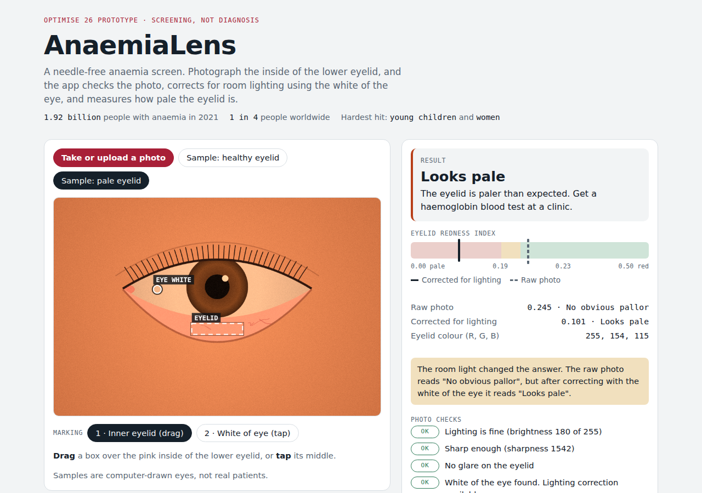

# AnaemiaLens 👁️

**A needle-free anaemia screen from a phone photo of the inner eyelid.** It checks that the photo is usable, corrects for room lighting using the white of the eye, and measures how pale the eyelid is.

**Live demo:** https://reihooneh.github.io/anaemialens/ · An early prototype explored for **Optimise 26**, Western Sydney University's student project showcase. It is a screening prototype, **not a diagnosis and not a medical device**.



## The problem

Anaemia affected about **1.92 billion people in 2021**, roughly one in four people worldwide, and hits young children and women hardest (GBD 2021 Anaemia Collaborators, *The Lancet Haematology*, 2023). Diagnosing it needs a blood test, which many people can't easily get. Clinicians have long looked for **pallor** (paleness) inside the lower eyelid as a quick clinical sign. A phone camera can measure that colour, but room lighting changes how it looks.

## What it does

1. **Capture:** take or upload a photo, then drag a box over the inner lower eyelid and tap the white of the eye.
2. **Check the photo:** brightness, sharpness and glare. A dark or blurred photo gets "Retake", never a guess.
3. **Correct the light:** the white of the eye should be neutral, so any tint it shows comes from the room. The app removes that tint from the eyelid too.
4. **Measure pallor:** a redness index from the eyelid's colour, shown raw and corrected on a scale, with a plain-language result.

The demo includes two computer-drawn sample eyes, a choice of room lights (daylight, warm bulb, cool LED, dim) and a "shaky hand" switch. Together they show why correction matters: under a warm bulb, the raw photo of the pale eyelid reads as normal, and the corrected reading catches it.

## Run it

It is a single HTML file with no build step. Open `index.html` in a browser, or serve the folder:

```bash
python3 -m http.server 8000      # then open http://localhost:8000
```

## Tests

```bash
npm install
npx playwright install chromium
npm test
```

There are 15 checks, run in a real browser:

- **Screening:** with correction, both samples are read correctly under all four room lights. Without it, a warm bulb hides the pallor, and the app says the light changed the answer. A blurred photo always gets "Retake".
- **Uploads:** a too-dark photo gets "Retake", a 6000 × 4000 photo is scaled down to 1000 pixels, and a fake image file is rejected cleanly without running anything inside it.
- **Privacy and security:** no network requests apart from the web fonts, and a Content-Security-Policy that forbids network connections from scripts.
- **Layout:** no sideways scrolling at phone, tablet or laptop widths.

CI runs the tests on every push and deploys the site to GitHub Pages only if they pass.

## Security and privacy

- **Photos never leave the device.** Everything is computed in the browser on a canvas, and nothing is stored.
- **The Content-Security-Policy** loads no scripts from anywhere else and sets `connect-src 'none'`, so even a bug could not upload a photo. It also blocks plug-ins, `<base>` tags and form posts.
- **Bounded work:** photos are scaled down to at most 1000 pixels before analysis.

See [SECURITY.md](SECURITY.md) for how to report a problem.

## Limitations

- **The thresholds are hand-set for the demo and are not medically calibrated.** The sample eyes are drawn by code, not photographed from patients.
- Marking the eyelid is manual.
- Next steps: train a model on the CP-AnemiC dataset (710 children with lab-measured haemoglobin), test on adults with the Eyes-defy-anemia dataset (Italy and India), and add automatic eyelid detection.

## Licence

MIT. See [LICENSE](LICENSE).
